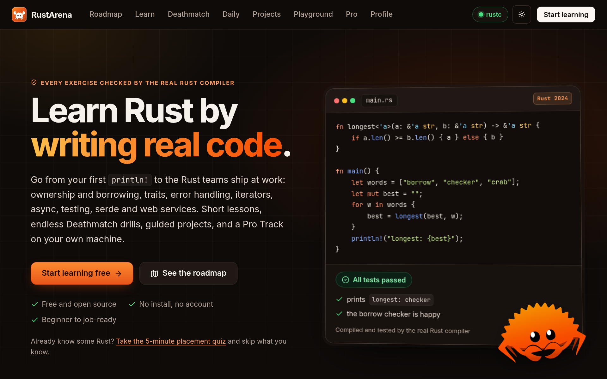
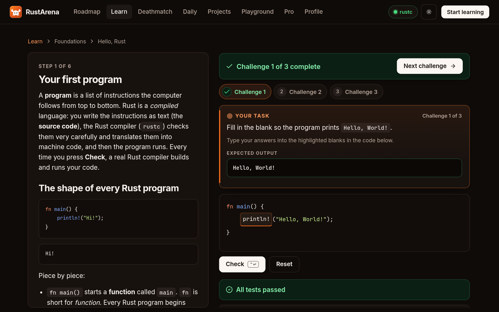
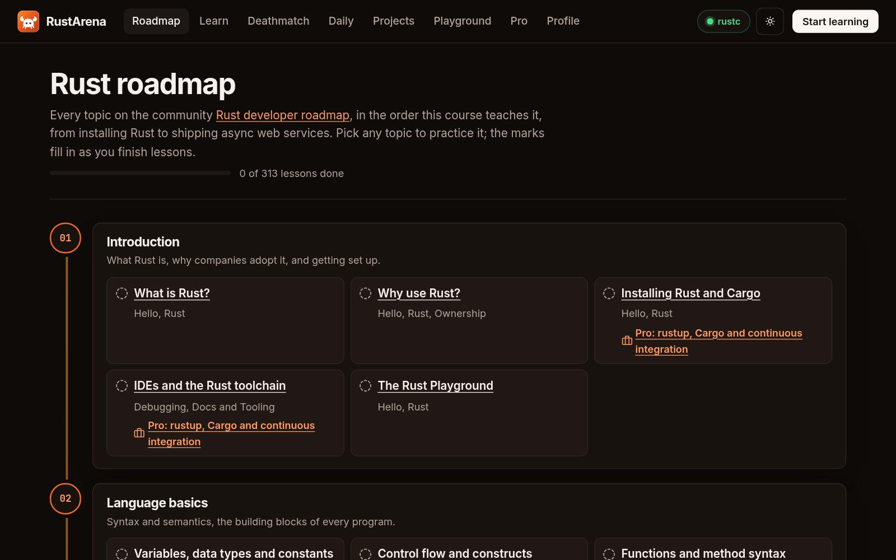
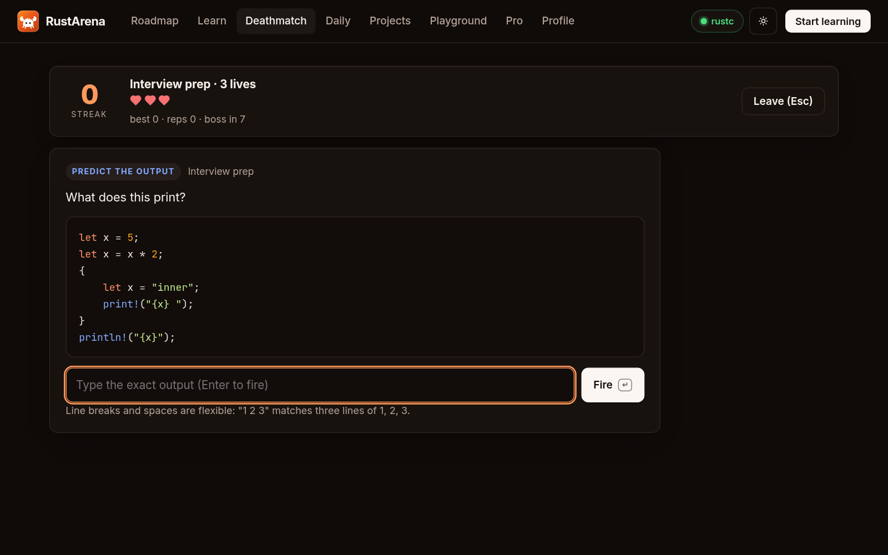
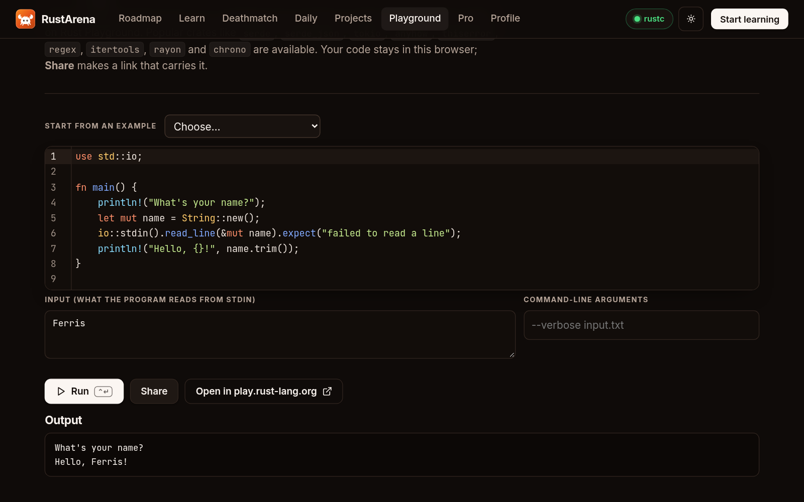
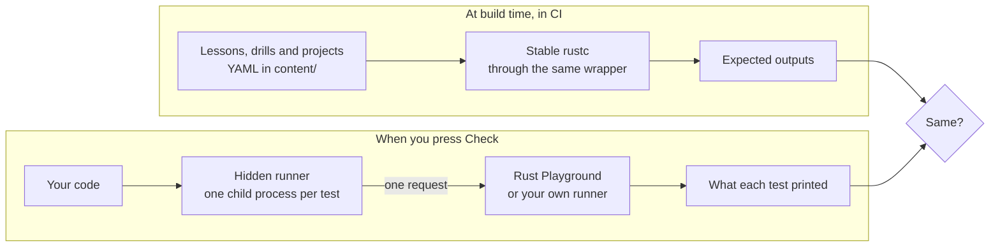

<div align="center">

<a href="https://rustarena.app"></a>

# RustArena

**Learn Rust by writing real code.**

Every exercise is compiled and tested by the real Rust compiler, borrow checker included.<br>
From your first `println!` to async web services. No install, no account.

[**Start learning**](https://rustarena.app) &nbsp;·&nbsp; [Roadmap](https://rustarena.app/roadmap) &nbsp;·&nbsp; [All modules](https://rustarena.app/learn) &nbsp;·&nbsp; [Playground](https://rustarena.app/playground) &nbsp;·&nbsp; [How it works](#how-it-works) &nbsp;·&nbsp; [Run it locally](#quick-start)

[](https://rustarena.app)
[](https://github.com/AntonyPerez0/RustArena/actions/workflows/deploy.yml)
[](https://www.rust-lang.org)
[](https://doc.rust-lang.org/edition-guide/rust-2024/)
[](https://roadmap.sh/rust)
[](https://react.dev)
[](https://www.typescriptlang.org)

<a href="https://rustarena.app">
  <picture>
    <source media="(prefers-color-scheme: dark)" srcset="docs/images/hero-dark.png">
    <source media="(prefers-color-scheme: light)" srcset="docs/images/hero-light.png">
    
  </picture>
</a>

| 48 | 313 | 936 | 936 | 10 | 12 | 58 |
|:---:|:---:|:---:|:---:|:---:|:---:|:---:|
| modules | steps | challenges | Deathmatch drills | guided projects | Pro Track projects | topic guides |

</div>

## Why RustArena

- **The real compiler, borrow checker included.** Every check is compiled by the current stable `rustc` (edition 2024). Its messages are shown with their snippet, a plain-English note for common error codes and a link to the official error index.
- **It follows the community roadmap.** The curriculum follows the [Rust developer roadmap](https://roadmap.sh/rust), and the Roadmap page links every topic on it to the lessons and projects that teach it, with your progress.
- **From zero to job-ready.** Ownership and borrowing, traits, error handling, iterators and async, then Rust at work: serde, anyhow and thiserror, command-line tools and web services. The Pro Track continues on a real machine with the tools Rust teams use.
- **No install, no account.** RustArena is a static site with no server of its own. Your code runs on the official [Rust Playground](https://play.rust-lang.org), or on your own computer with the local runner.

## What's inside

| Feature | What you get |
|---|---|
| **Course** | 48 modules and 313 steps, from `println!` to professional Rust. Early steps are fill-in-the-blank; later steps have you write whole programs, functions checked by hidden `#[test]`s, and your own test suites graded against planted bugs. Every step has hints you reveal one at a time and a "show solution" escape hatch. |
| **Roadmap** | Every topic on roadmap.sh/rust, in order, linked to the lessons and projects that teach it. |
| **Deathmatch** | 936 quick drills, including 78 interview questions: predict the output, fill the token, spot the bug, and "does this compile?" against the borrow checker. Each drill unlocks when you finish the lesson step that teaches it, and every 8th rep is a boss rep you compile for real. One life, three lives, a spaced-review warm-up or interview prep. |
| **Projects** | 10 guided multi-milestone builds, from a to-do list manager and a bank ledger to a calculator with a real parser, a log analyzer, a generic matrix library and a parallel task scheduler. Your code carries forward between milestones. |
| **Pro Track** | 12 projects on a real machine (GitHub Codespaces or your own computer): rustup and Cargo, Git and pull requests, rustfmt and clippy, unit, integration and property tests graded by mutation testing, clap, Tokio networking, an axum REST API, SQLx and SQLite, criterion benchmarks, and a capstone service with Docker and CI. Each is graded by GitHub Actions in your own repository. |
| **Playground** | Run any Rust program with input and command-line arguments, with serde, tokio, anyhow, thiserror, regex, itertools, rayon and chrono available, and share it as a link that carries the code. |
| **Topics** | 58 short reference pages on the core ideas, each with a compiled and tested example, plus a "Where to go next" page of books, practice sites, projects and job advice. |
| **Daily challenge, placement quiz and certificates** | One problem a day with a streak, a quiz that lets experienced learners skip ahead, and printable certificates for finishing the course and the Pro Track. |
| **Comfort** | Light and dark themes in Rust's colors, adjustable text size, a symbol bar for phone keyboards (`&`, `::`, `=>`, `'a`), "Report a problem" on every exercise, and offline reading once visited. |
| **Your progress** | Saved in the browser. Move it between devices with a transfer link, a QR code, a private GitHub Gist or a file. |

Every feature is described in detail in [`docs/ARCHITECTURE.md`](docs/ARCHITECTURE.md).

## Screenshots

<table>
  <tr>
    <td width="50%" valign="top">
      <a href="docs/images/lesson.png"></a>
      <br><sub><b>Lessons.</b> A short lesson and three challenges per step, checked by the real Rust compiler.</sub>
    </td>
    <td width="50%" valign="top">
      <a href="docs/images/roadmap.png"></a>
      <br><sub><b>Roadmap.</b> Every topic on roadmap.sh/rust, linked to the lessons that teach it.</sub>
    </td>
  </tr>
  <tr>
    <td width="50%" valign="top">
      <a href="docs/images/deathmatch.png"></a>
      <br><sub><b>Deathmatch.</b> Endless quick drills with lives, streaks and boss reps.</sub>
    </td>
    <td width="50%" valign="top">
      <a href="docs/images/playground.png"></a>
      <br><sub><b>Playground.</b> Run any Rust program with input and arguments, with popular crates available.</sub>
    </td>
  </tr>
</table>

## How it works



- **Where code runs.** The site sends your code to the [Rust Playground](https://play.rust-lang.org), the official service behind the examples in The Rust Programming Language book, which compiles it with the current stable `rustc` (edition 2024, debug build) and runs it.
- **One request per check.** A small hidden runner starts your program once per test case as a child process, each with its own input, arguments and files, a 2 second time limit and a 64 KB output cap. One request grades every test, and input works even though the Playground has none.
- **Function and test exercises.** Function exercises append hidden `#[test]`-style functions. "Write the tests" exercises run real `cargo test`, then run again with each planted bug to check that your tests catch it.
- **Your own runner.** `npm run runner` serves the same API with your own Rust installation, and Settings switches the site to it. It works offline and suits classrooms.
- **Content.** The build compiles and runs every reference solution, worked example and drill through the same wrapper the browser uses, so expected outputs come from real runs.

Running code needs a connection to the Rust Playground, or a runner you host. [`docs/ARCHITECTURE.md`](docs/ARCHITECTURE.md#how-code-runs) has the full write-up, with the [known limits](docs/ARCHITECTURE.md#known-limits).

## Curriculum

<details>
<summary><b>48 modules</b>: from Hello, Rust to a capstone of real tickets</summary>

<br>

| Phase | Modules | Topics |
|---|:---:|---|
| Foundations | 1 to 8 | Hello, Rust, variables and mutability, numbers, booleans and characters, functions, control flow, tuples, arrays and a first `Vec`, working with text, reading input |
| Ownership | 9 to 11 | Ownership, borrowing, slices |
| Structuring data | 12 to 18 | Structs, methods, enums and `Option`, patterns and matching, vectors, hash maps and sets, strings in depth |
| Errors and abstraction | 19 to 25 | Error handling with `Result`, custom error types, generics, traits, standard library traits, lifetimes, trait objects |
| Idiomatic Rust | 26 to 30 | Closures, iterators, modules, crates and Cargo, smart pointers, testing |
| Concurrency and async | 31 to 33 | Threads, sharing data between threads, async Rust with Tokio |
| Advanced Rust | 34 to 37 | Advanced traits, macros, unsafe Rust, performance |
| Rust at work | 38 to 43 | JSON and serialization with serde, error handling with thiserror and anyhow, command-line tools, web services and JSON APIs, design patterns and idioms, debugging, docs and tooling |
| Algorithms and data structures | 44 to 47 | Stacks, queues, heaps and ordered maps, searching, sorting and classic techniques, recursion and dynamic programming, graphs and trees |
| Capstone | 48 | Real tickets |

The full outline is in [`docs/AUTHORING.md`](docs/AUTHORING.md).

</details>

## Quick start

Needs Node 22 and Rust (stable, via [rustup](https://rustup.rs)).

```bash
git clone https://github.com/AntonyPerez0/RustArena.git
cd RustArena
npm install
npm run content    # compile and run every lesson, drill and project; writes src/generated/
npm run dev        # http://localhost:5173/
npm run runner     # optional: run code on this machine instead of the Playground
```

| Script | What it does |
|---|---|
| `npm run content` | Builds the generated content from `content/**/*.yaml`, compiling and running everything with your Rust toolchain |
| `npm run runner` | A local stand-in for the Rust Playground on `127.0.0.1:8787` |
| `npm run build` | Type-checks and builds `dist/`, packs the Pro Track starter, and pre-renders every page |
| `npm run test:e2e` | Drives the real UI in headless Chromium, with code run by the local runner, including axe accessibility scans and SEO checks |
| `npm run check:pro` | Checks every Pro Track grader: the starter must fail and the reference solution must pass |

More on each script, and how to deploy your own copy to GitHub Pages, is in [`docs/DEVELOPMENT.md`](docs/DEVELOPMENT.md).

## Quality gates

[`deploy.yml`](.github/workflows/deploy.yml) builds and tests every pull request and every push to `main`, and publishes to GitHub Pages only after the first two of these pass:

- **Content build**: every lesson solution, worked example, drill and project milestone compiles and runs with the real Rust compiler, and every expected output must match.
- **Browser tests**: the real UI in headless Chromium, with axe (WCAG 2.2 AA) on every page type in both themes, phone widths, offline use and SEO checks.
- **Lighthouse**, on pull requests: performance, accessibility, best practices and SEO scores.
- **Pro Track graders**, when `pro-track/` changes: the untouched starter must fail and the starter plus its solution must pass.
- **Outside links**, every Monday.

## Project layout

```
content/       Lessons, drills, projects, topics and the roadmap (YAML)
pro-track/     The Pro Track: starter repository, graders and reference solutions
runner-deps/   The crates lesson code may use
scripts/       Content build, local runner, pre-rendering and browser tests
src/           The site (React, TypeScript): pages, editor, grader
docs/          Architecture, development notes, the content formats and the domain setup
```

## Documentation

| Document | What's in it |
|---|---|
| [Architecture](docs/ARCHITECTURE.md) | Every feature of the site, how code runs and is graded, accessibility, SEO, the known limits and the branding |
| [Development](docs/DEVELOPMENT.md) | Running locally, the scripts and deploying to GitHub Pages |
| [Writing content](docs/AUTHORING.md) | The YAML formats for lessons, exercises, worked examples and drills, the determinism rules and the full curriculum outline |
| [Custom domain](docs/CUSTOM-DOMAIN.md) | Setting up a domain on Cloudflare for the published site |
| [The Pro Track](pro-track/README.md) | For maintainers: the starter repository, the reference solutions and how the graders are checked |

## The Arena sites

RustArena is one of four sites that teach a language the same way, free.

| Site | Teaches | Source |
|---|---|---|
| [C/C++ Arena](https://cpparena.com) | C and C++ | [cpp-arena](https://github.com/AntonyPerez0/cpp-arena) |
| [Java Arena](https://javaarena.com) | Java | [Java-Arena](https://github.com/AntonyPerez0/Java-Arena) |
| **[RustArena](https://rustarena.app)** | Rust | this repository |
| [Python Arena](https://pythonarena.org) | Python | [pythonarena](https://github.com/AntonyPerez0/pythonarena) |

## Feedback

Found a mistake in a lesson, or an exercise that rejects a correct answer? Every exercise on the site has a "Report a problem" link, or you can [open an issue](https://github.com/AntonyPerez0/RustArena/issues/new) here.

## Credits

- Code is compiled and run by the [Rust Playground](https://play.rust-lang.org), a free, shared service.
- The curriculum order follows [roadmap.sh/rust](https://roadmap.sh/rust). RustArena is not affiliated with roadmap.sh.
- **Ferris the crab**, the community's unofficial mascot by Karen Rustad Tölva, is in the public domain (CC0), from [rustacean.net](https://rustacean.net/). The RustArena logo is our own drawing of a crab.

RustArena uses the word "Rust" only to say what it teaches. It isn't affiliated with or endorsed by the Rust Foundation or the Rust Project, and it doesn't use the Rust logo, which is a trademark of the Rust Foundation.
